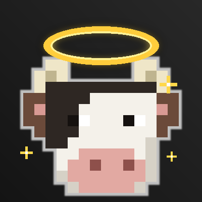

<h1 align="center">Mythborn</h1>

Rare lucky, alpha and titan mobs: bigger, glowing, tougher and full of loot

  
  
  
  
  
  

Any mob can spawn with a level. It grows bigger, glows in the dark, wears a colored veil and leaves a trail of particles, and it drops much more when it dies. The rarer the level, the bigger the reward.

## Three levels

| | Lucky | Alpha | Titan |
|:--|:--:|:--:|:--:|
| Look | Golden sparkles | Blue soul flames | Red embers |
| Size | ×1.5 | ×2 | ×3 |
| Chance | 1 in 200 | 1 in 1,000 | 1 in 4,000 |
| Loot | ×2 | ×3 | ×4 |
| Experience | ×2 | ×3 | ×5 |
| Monster health | ×2 | ×3 | ×4 |
| Monster damage | ×2 | ×2.5 | ×3 |
| Monster speed | ×1.3 | ×1.2 | normal |
| Mount speed | ×1.3 | ×1.4 | ×1.5 |
| Mount jump | ×1.2 | ×1.3 | ×1.4 |
| Body armor | | 25% | 50% |
| Boss bar | | | Monsters and wild animals |

The chances are the defaults and can be changed in the mod config.

## Monsters

- More health, damage and speed, so a lucky skeleton is a real fight
- Titan monsters show a boss bar with their name and health

## Animals

- Alpha and titan wild animals charge and kick nearby players, and titans also stomp
- Wild titans show a boss bar too, and tamed ones defend their owner
- Babies inherit a level: always if both parents have one, half the time if only one does, and two parents of the same level have a 10% chance of a baby one level higher

## Mounts

- Lucky, alpha and titan mounts run faster and jump higher without hurting their rider
- Titans take no fall damage

## Armor

- Alpha and titan mobs can spawn wearing body armor, vanilla or from <a href="https://modrinth.com/mod/critter-armory">Critter Armory</a>
- The armor can drop when they die

## Particle styles

Five styles to choose for each level: golden, starry, soul, embers and totem.

## Command and advancements

- `/lucky <targets> [lucky|alpha|titan]` gives a level to any mob (operators only)
- <strong>Lucky Day!</strong>: kill or tame your first lucky, alpha or titan mob
- <strong>Titan Slayer</strong>: kill a titan

## Multiplayer

Install it on the server and every player sees the bigger mobs and the particles, even without the mod. Players with the mod also see the colored veil, the light and the names.

## Configuration

The chance and particle style of each level, the aggressive animals, the boss bar and the colored veil can be changed. Bosses from any mod (the `c:bosses` tag), the Elder Guardian, the Warden, villagers and wandering traders never get a level, and mobs from spawners, spawn eggs and `/summon` never roll.

## Dependencies

<strong>Fabric/Quilt:</strong>

- <a href="https://modrinth.com/mod/fabric-api">Fabric API</a>
- <a href="https://modrinth.com/mod/modmenu">Mod Menu</a> <strong>(Optional)</strong>

<strong>Optional on every loader:</strong>

- <a href="https://modrinth.com/mod/critter-armory">Critter Armory</a>: its animal armor can spawn on alpha and titan mobs
